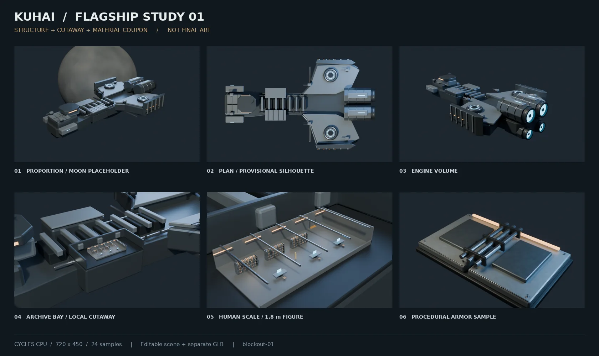

# 云端结构草模 01

日期：2026-10-10。状态：**可编辑结构与材质测试件，未获最终造型确认**。

本轮把云端能完成的流程实际跑通：参考查阅 → 程序化草模 → 独立舱区外壳 → 局部材质样板 → CPU 预览 → 独立 GLB → 跨目录重新打开和渲染。尚未替换网站入口，未改动博客 UI，未连接或调用用户本地电脑。

## 实际环境

| 项目 | 检测结果 |
| --- | --- |
| 原始环境 | 无 `blender` 可执行文件、无 `bpy`、无 `nvidia-smi`、无暴露的 NVIDIA/DRI 设备 |
| 容器配额 | 8 核 CPU（`cpu.max=800000 100000`）、8 GiB 内存上限 |
| CPU 标识 | AMD EPYC 9V74；宿主机型号的核心数不是容器可用配额 |
| 本轮配置 | 独立 Python 3.11.17 环境，Blender Foundation `bpy 4.5.14 LTS`；构建 `62c1db4208e8` |
| Cycles 发现的设备 | CPU；未启用 GPU |
| 渲染设置 | 6 线程、4 次最大光线反弹、AgX、降噪、固定采样 |

Blender Python 模块来自 [Blender Foundation 发布的 bpy](https://pypi.org/project/bpy/4.5.14/)。这是实际运行的 Blender 建模与 Cycles 渲染环境；云端没有安装桌面 GUI 可执行程序。

## 当前资产

| 资产 | 结果 | 使用边界 |
| --- | --- | --- |
| `flagship-blockout.blend` | 1,450,606 bytes；可编辑对象、倒角、程序化材质、灯光、8 个机位 | 草模母版，不是已完成的高精度源模型 |
| `flagship-web-study.glb` | 4,282,512 bytes（4.08 MiB），64,400 三角形，18 个合并网格，10 材质 | 无纹理结构样本；未做 LOD、纹理烘焙或传输压缩 |
| 档案室 | 外壳 6 个对象；内部 225 个对象，含 1.8 m 占位人物 | 室内位置、大小与家具为创作试排；未定稿 |
| 材质样板 | 装甲层、服务盖、螺栓、管线和工作灯 | 测试金属/漆面/粗糙度，尚无最终磨损和烘焙贴图 |
| 星体 | 同场景主光下的程序化示意球体 | 不是最终星球、大气效果或准确天体尺度 |

源模型与网页导出位于两个不同 Blender 场景。导出按语义与材质合并，保留 `hull`、`archive_shell`、`archive_interior`，后两者附带 `room_id=archive`。18 个网格不是所有浏览器渲染通道总绘制次数的实测值。

## 实测渲染

以下是第二次完整批次的实测；此前初测用于发现并修复喷口被实心盖遮住的问题。所有数字都是离线 CPU 渲染，不是网页帧率。

| 机位 | 像素 / 采样 | 渲染墙钟时间 |
| --- | --- | ---: |
| 整舰 / 示意星体 | 720×450 / 24 | 3.129 s |
| 俯视 | 720×450 / 24 | 3.270 s |
| 侧视 | 720×450 / 24 | 2.465 s |
| 引擎尾部 | 720×450 / 24 | 2.885 s |
| 腹部 | 720×450 / 24 | 2.781 s |
| 档案室所在舱区 | 720×450 / 24 | 5.407 s |
| 档案室内部 | 720×450 / 24 | 7.951 s |
| 装甲材质样板 | 720×450 / 24 | 3.790 s |
| 迁移目录后的档案室 | 960×600 / 32 | 17.812 s |

第一批 8 张渲染的进程 RSS 高水位约 810 MiB；独立迁移小样约 909 MiB。它包括 Blender/Python 进程开销，是操作系统记录的内存高水位，不是 GPU 显存，也不是仅场景网格占用。

结论：当前草模和低成本材质预览可以继续在云端完成，**本轮没有必须交给本地 GPU 的算力瓶颈**。这些结果不外推到最终高面数、高清纹理、复杂大气、4K/8K 渲染或批量烘焙。

## 迁移和结构检查

已复制场景到另一目录，重新打开并运行检查和 960×600 渲染：

- 无未打包的外部图片、无外部链接 `.blend`；默认渲染路径为相对路径。
- 档案室外壳、内部与舰体对象分开。
- 隐藏局部外壳时，所有舰体对象和相机变换保持不变。
- 档案室家具与梁架处于预留舱区包围范围内。
- GLB 文件长度、容器头、三个语义角色、索引三角形统计和内部资源边界检查通过。

没有把上述检查表述为浏览器悬停测试、Windows 测试或 3060 Ti 实测；网页接入仍需独立验证。

## 交付及校验

可迁移包：`kuhai-flagship-blockout-01.zip`，随本轮会话持久交付。包含源 `.blend`、独立 `.glb`、全部生成与渲染脚本、配置、启动说明、预览、依赖清单与检查记录。第三方参考图不随包提供；当前程序化材质无需外部贴图。

| 文件 | SHA-256 |
| --- | --- |
| `flagship-blockout.blend` | `b93ef983abbe85ac92a771f61ce76199e8f9084f700cb633aa10e6053c08fde7` |
| `flagship-web-study.glb` | `ad994432700b1ad9ae66d182bf9d2755788b915cf195746c33dda03dfa34303b` |

第一版的 [生成脚本与启动说明](https://github.com/kuhaiyongcun-droid/Shirone/tree/ee771c1c6be389f8402fd1b1583ead55b62490ca/tools/flagship) 已固定于历史版本；当前工具目录可能继续迭代。脚本不自动使用本地电脑、云 GPU 服务或收费资产。

## 下一轮重点

目前侧面偏平、肩翼平板化、舰桥仍有方盒感，需要先依据统一的电影多视角参考修正主轮廓。然后细化档案室外壳与维护结构、局部材质和环境光，继续用低分辨率预览判断。高精度整舰、高清材质与最终电影级构图均未完成，质量目标保持。

相关记录：[分工决策](../decisions/0002-cloud-local-production.md)、[参考与推演边界](../references/2026-10-10-proportion-study.md)。
