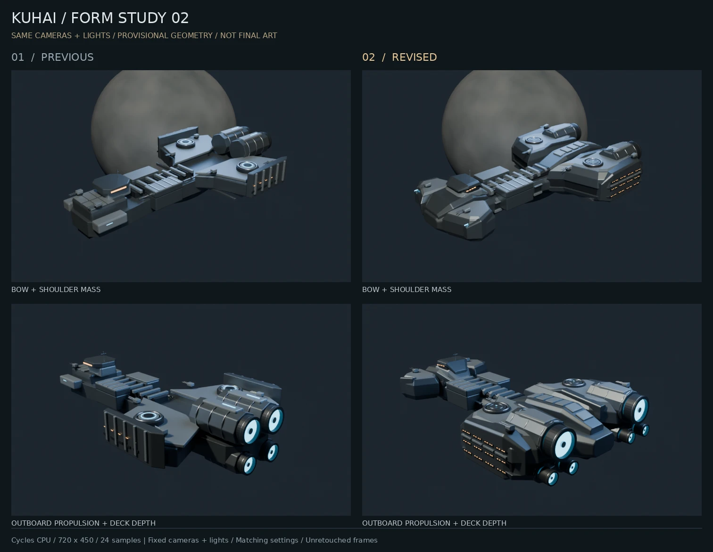
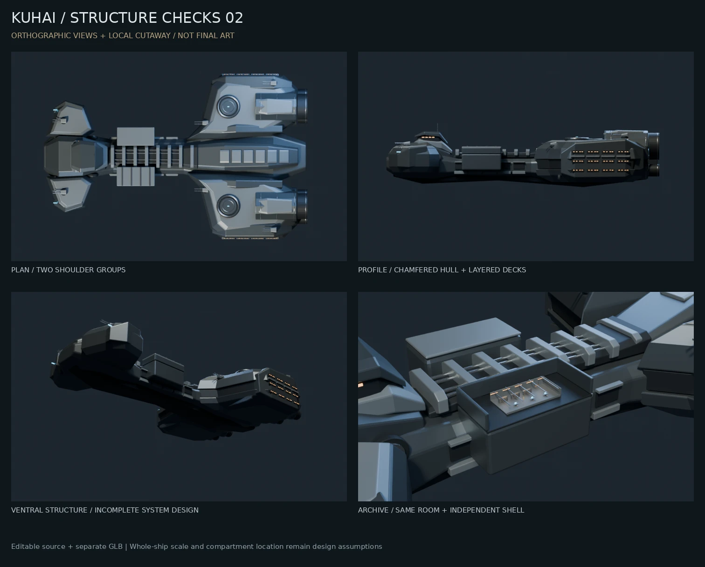

# 云端结构草模 02

日期：2026-10-10。状态：**多视角体量修订；最终休伯利安号造型与电影质感未定稿**。

## 本轮修改

1. 中央舰体改用变截面龙骨、斜切腹部和分段侧壁，形成纵向体量变化。
2. 展开前肩，舰桥由方盒改为倾斜底座、凹入窗带与后掠顶甲。
3. 后肩改成厚实分层体量，包括上部装甲、设备凹层、下部斜面和带窗外壁。
4. 推进组件分置左右肩部，各试排一大两小喷口，中央留出较低的工程结构。六喷口及其位置是本项目暂定解释，没有声称是官方精确配置。
5. 网页导出保留原模型的角点法线，避免合并后把平滑环件直接变成三角形明暗块。

本轮继续制作主舰，不改博客界面，也未替换线上首页。固定机位、灯光与档案室内部原始几何已与第一版比较，检查一致。局部外壳仍独立，剖视只隐藏该外壳。

## 资产与依赖

| 项目 | 本轮结果 |
| --- | --- |
| 可编辑源场景 | `flagship-blockout.blend`，2,263,246 bytes；349 个舰体对象、6 个档案室外壳对象、225 个室内对象 |
| 网页结构样本 | `flagship-web-study.glb`，4,473,756 bytes（4.27 MiB），98,652 三角形，18 网格、10 材质 |
| 材质 | 程序化源材质；GLB 为简化 PBR，无外部图片依赖 |
| 模型软件 | Blender Foundation `bpy 4.5.14 LTS` / Python 3.11.17，与上一版一致 |
| 对比板 | Pillow 12.3.0；只排版原始渲染图，不重打光或修饰模型 |
| 云端资源 | 8 核 CPU 配额、8 GiB 内存限制；实际渲染使用 6 线程，未发现可用 GPU |

源场景和网页模型分别维护。当前 GLB 仍含草模室内几何，不是正式网页预算；98,652 三角形不代表已经适配手机，18 网格也不等于所有渲染通道的实际绘制次数。LOD、分区加载、贴图烘焙、传输压缩和浏览器性能测量留在网页接入阶段。

## 实测

全部为 Cycles CPU、AgX、降噪、固定采样、4 次最大反弹。正式比较批次在修正尾部检修盖贴合之后重跑；不是前一批试渲染的数字。

| 机位 | 720×450 / 24 次采样 |
| --- | ---: |
| 整舰 | 3.289 s |
| 俯视 | 3.714 s |
| 侧面 | 2.651 s |
| 尾部 | 3.368 s |
| 腹部 | 3.053 s |
| 档案室所在舱区 | 5.616 s |
| 档案室内部 | 7.758 s |
| 装甲材质样板 | 3.242 s |

完整批次进程 RSS 高水位约 822 MiB。复制到另一目录后，960×600 / 32 次采样的尾部小样耗时 6.487 s，进程 RSS 高水位约 953 MiB。这些是离线渲染耗时和系统内存，不是浏览器帧率或 GPU 显存。

**本轮未遇到需要本地 GPU 的算力瓶颈。** 没有连接用户电脑或使用付费服务，最终质量目标保持。以上测试不能外推到高清纹理、复杂体积效果、最终整舰或批量烘焙。

## 验证范围

- 8 个机位已实际渲染和目视检查，包括新版本尾部检修盖的贴合修正。
- 相机、灯光及档案室顶点/面连接/材质名/对象变换与第一版一致。球体面列表的无关排序变化不当作造型变化。
- 源舰体网格均为闭合、有正有向体积的单个部件；没有声称各装甲装配件之间不重叠或已完成物理验证。
- 剖视时舰体和相机变换不动；室内几何位于预留舱区范围内。
- GLB 容器、索引统计、法线与顶点数量、三个语义角色及无外部依赖检查通过。
- 场景迁至另一目录后重新打开、检查、渲染通过。未在 Windows、RTX 3060 Ti 或浏览器上验收。

## 交付

`kuhai-flagship-blockout-02.zip` 包含当前 `.blend`、独立 `.glb`、脚本、版本依赖、相对路径资源说明、全部检查预览、渲染记录、源文件校验值和启动步骤。第一版任务包继续保留。

| 文件 | SHA-256 |
| --- | --- |
| `flagship-blockout.blend` | `81f085d5cb24dc8a0ee3b28e7202018f3700599c4e0552fafa7d045b21aba127` |
| `flagship-web-study.glb` | `013ad0d6bba3b0ff6566292b37badf96aad311323953984bebaea884f43bac2f` |

包本身的大小与校验值记录在 [交付清单](../assets/blockout-02-delivery.json)。[启动说明](../../../tools/flagship/README.md) 包含桌面 Blender 与 CPU 小样步骤；只有用户明确连接家中电脑后，才按分工检查目标机器并决定本地任务。

## 下一步

继续追溯主参考的原始发布上下文，补足舰首正面与侧面关系。当前仍有腹部偏空、舱区外壳偏方、肩部外壁过整齐、喷口发光面过均匀的问题。下一轮先选一段肩部装甲及推进组件做更有质感的局部样板，以低成本预览确定金属、漆面、缝隙、工作灯和磨损尺度，再推广到整舰。星体仍是示意球体，全舰电影级渲染与完整内部工程尚未开始。

相关：[本轮参考与设计推演](../references/2026-10-10-form-study-02.md)、[云端与本地分工](../decisions/0002-cloud-local-production.md)。
