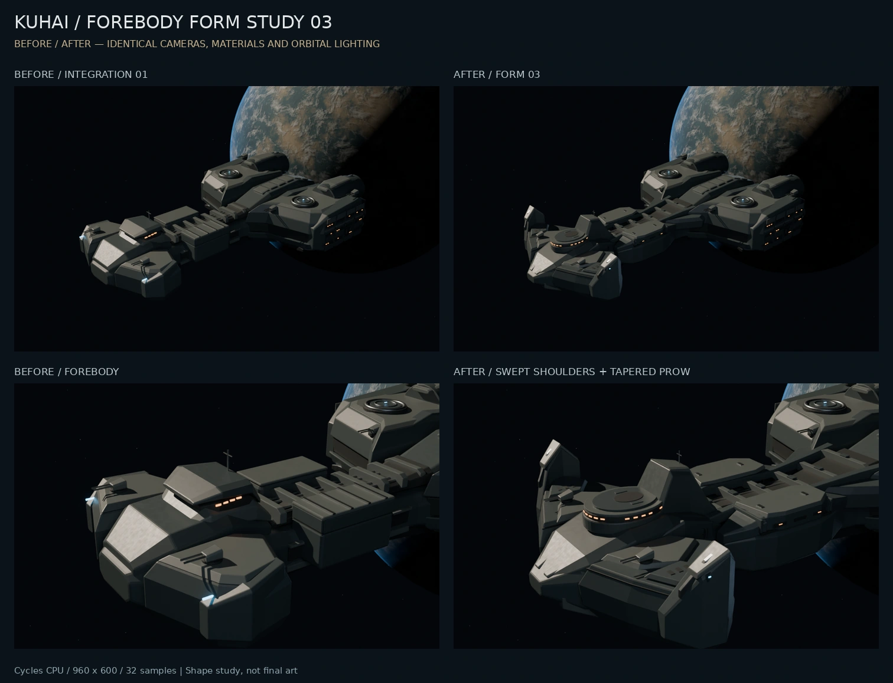
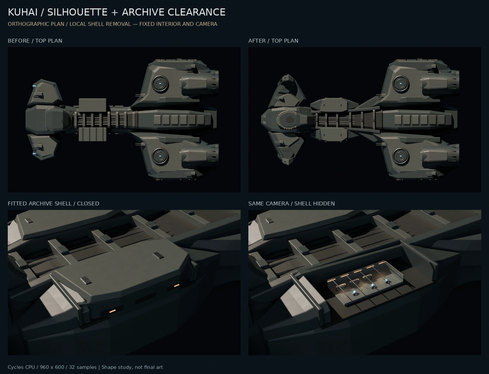

# 舰首与中段形体样板 03

日期：2026-10-12。以 integration-study-01 为输入，完成舰首、前肩和中段连接的可编辑修订。仍为待审阅的形体稿，未替换网站，未生成新的整舰网页模型。

左列为整舰整合 01，右列为本轮稿。两列材质、光源、相机、曝光和采样相同；对比图仅缩放排版，没有裁切、补光或修图。

## 本轮改动

- 舰首收尖、前肩后掠、翼端抬高；甲面划分主装甲、凹槽和少量维护区域。
- 舰桥前部改为椭圆阶梯体量，后方接上抬脊背，保留窄窗带和小型设备。
- 中段舱区通过斜接段、下部渐变体和低矮装甲接入舰体，减少外挂盒体感。
- 档案室顶甲、外壁和附属件统一归入可移除外壳，室内对象保持原样。

[参考记录](../references/2026-10-12-form-study-03.md)区分实际图像、作者说明和项目推演。尺寸、圆形舰桥布局与翼端功能没有充分官方依据。

## 验证与数据

| 项目 | 结果 |
| --- | --- |
| 环境 | 云端 Linux；Blender 4.5.14 LTS / Python 3.11.17；CPU，6 线程 |
| 主舰 | 1161 个对象、228648 个求值网格三角形；含室内，不含字体、环境和隐藏对照 |
| 源文件 | `flagship-form-study-03.blend`，3576714 bytes |
| 网格 | 单体网格闭合、正体积、正变换；左右后部细节镜像通过 |
| 对照 | 旧版外部几何、材质名、世界变换与输入一致；实际显示并重新求值后检查 |
| 保留项 | 星体、光源、后部细节、四个原机位和曝光一致；档案室网格、材质、变换一致 |
| 局部避让 | 新增求值网格与档案室预留区的三角形/盒体交叉和实体包含检查通过 |
| 迁移 | 单独复制 `.blend`，无旁置贴图，打开、检查及渲染成功；图像内嵌、相对路径 |
| 网站 | 未验收本轮浏览器、手机帧率或显存；制作面数不作网页预算 |

960×600 / 32 次采样实测：整舰斜视 11.885 秒、侧面 6.260 秒、舰首近景 10.388 秒、顶视 8.155 秒、舱区闭合 16.949 秒、剖视 17.306 秒。整舰批次进程 RSS 高水位约 1199.52 MiB。这是离线预览时间，不是网页 FPS。

避让仅针对 `[-99,-47,16.6]` 至 `[-61,-27,22.8]` m 的室内占用预留区，不是全舰碰撞、强度、通道或设备维护验证。外壳开合只改可见性，没有移动舰船或相机。

## 交付与后续

任务包 `kuhai-flagship-form-study-03.zip` 包含当前 `.blend`、原始上一轮输入、纹理、脚本、版本依赖、原始预览和迁移记录。在当前对话中获取同名任务包；校验值见 [交付清单](../assets/form-study-03-delivery.json)，运行方式见 [FORM_STUDY.md](../../../tools/flagship/FORM_STUDY.md)。

当前云端足以完成小样。下一步制作轻量的可旋转审阅样板，检查更多角度、舱区高亮、局部剖视和触屏操作；网页资产另做低模、UV、烘焙和压缩。高精度细化、高清批量渲染待形体方向明确后推进。

只有用户明确连接家中电脑后，才核实目标、授权、Blender、驱动和可用显存并做小样；本包不代表已有本地访问权限。博客布局、线上发布和中文化分支不属于本轮修改。
