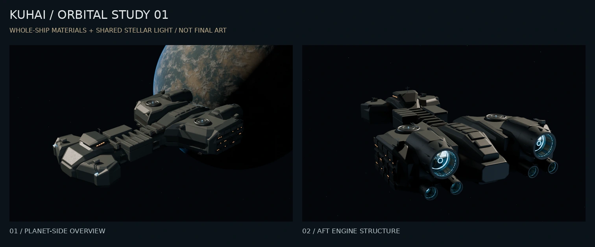
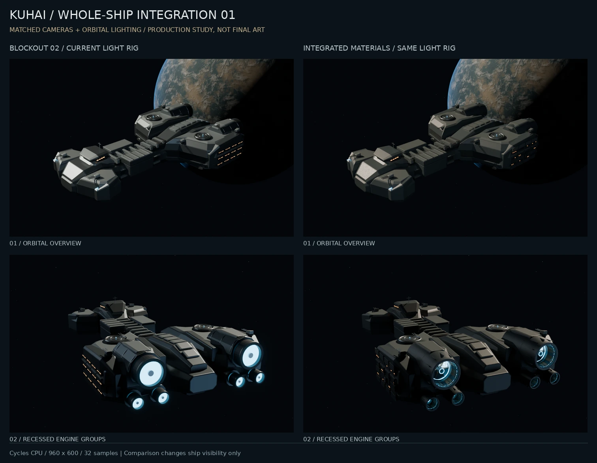

# 整舰材质与星体光照样板 01

日期：2026-10-12。状态：**阶段 3 的整合预览；舰型和最终美术质量未定稿**。

## 本轮完成

从已经保存的结构草模 02 与材质样板 01 恢复工程，并核对两个任务包及输入 `.blend` 的校验值。复用上一轮实际模型和纹理，没有以重新生成图片替代三维场景。

- 把局部漆面、裸露合金和内衬材质用于整舰外部；左右肩部采用同一套可编辑深喷口。
- 从原有 96 个重复甲板灯窗中移除 64 个，保留分组亮窗，减轻栅格排列感。大型装甲分区仍偏规整。
- 加入虚构星体表面、云层、稀疏星点与薄大气边缘。舰船和星体共用恒星方向；比较视图不会跟着镜头重新摆放星体。
- 缩小过大的星体构图占比，收敛其暗面光边；喷口口沿和内层发光略增强，以便在整舰距离辨认结构。
- 保留档案室的几何、材质和物体变换，也保留其既有工作灯；没有改博客 UI 或部署首页。

对比图两侧均使用本轮星体、主光、相机和 960×600 / 32 次采样设置。它比较的是整舰外部变化，不是把旧预览的不同灯光混作材质差异。

## 参考与创作边界

本轮阅读并目视了 NASA 的 [Sunset over Western South America](https://science.nasa.gov/earth/earth-observatory/sunset-over-western-south-america-50205/)（ISS027-E-12224，2011-04-12 摄影），用来观察明暗交界、薄大气边缘和云顶层次。该页面解释了大气散射使昼夜过渡呈扩散边界。这里只借鉴观察关系；NASA 照片没有作为纹理或打包资产。

星体完全由程序化节点制作，半径、距离、地表和云层是构图假设。当前大气只是按共享恒星方向衰减的表面近似，没有完成物理散射积分。星体方向补光与相机侧补光是明确的美术辅助，不声称严格再现真空环境的全部能量关系。

唯一外部贴图仍是上一轮采用的 [Blue Metal Plate](https://polyhaven.com/a/blue_metal_plate) 粗糙度，Rob Tuytel / Poly Haven，CC0；用途、原文件和派生关系见 [素材登记表](../assets/registry.csv) 及任务包 `ATTRIBUTION.md`。没有新增游戏提取资产或二创模型。

## 实测与验证

云端仍为 Blender Foundation `bpy 4.5.14 LTS` / Python 3.11.17，8 核 CPU 配额与 8 GiB 内存上限，使用 6 个 CPU 线程；无可用 GPU。

| 视图 | 参数 | 耗时 |
| --- | --- | ---: |
| 整舰与星体 | 960×600，32 次采样 | 12.064 s |
| 舰尾喷口群 | 同上 | 8.806 s |
| 舷侧 | 同上 | 6.416 s |
| 肩部近景 | 同上 | 17.224 s |
| 仅复制 `.blend` 后重开渲染 | 640×400，16 次采样 | 3.768 s |

最终四视图渲染批次 RSS 高水位 1172.42 MiB。离线渲染时间和系统内存不能当成网页帧率或 GPU 显存数据；目前没有需要本地 GPU 交接的实测瓶颈。

当前舰船各集合共 1128 个对象；网格经修改器计算为 **218,572 三角形**，含档案室、不含字体、环境及隐藏对照。以下检查均已通过：单个网格闭合与正向体积、镜像后实际世界坐标、档案室数据保留、三张整舰机位不裁切、对比及剖视开关不改变物体/相机变换、共享恒星方向、贴图及其打包路径位于相对目录。只复制 `.blend`、不给旁置贴图也可重新打开和渲染。

迁移过程中还修正了追加对象后尚未更新变换就镜像、以及另存文件自动把相对路径改回旧目录的问题，并把这两项纳入检查。代码仓 Astro 检查为 283 文件、0 错误、0 警告、0 提示。

## 交付与下一步

任务包 `kuhai-flagship-integration-study-01.zip` 包含当前源模型、两份可再生成的前序输入、原始/衍生粗糙度图、生成/渲染/检查脚本、依赖、预览、实测记录及启动说明。详见 [使用说明](../../../tools/flagship/INTEGRATION_STUDY.md) 与 [交付记录](../assets/integration-study-01-delivery.json)。

这次没有生成新的整舰网页 GLB，也没有做浏览器性能验收。网页低模、贴图图集、LOD、压缩与星体背景层继续独立制作，不直接沿用此源场景的全部几何与深度范围。

接下来优先回到舰首/前肩辨识度、中段体量和装甲的大中小分区。当前长轴与舱区衔接仍有明显草模感，单纯加噪声或提高采样不会解决这些问题。以本轮统一灯光检查后续形体修改，再继续优化材质；暂不铺开整舰密集细节和最终高清批量渲染。
