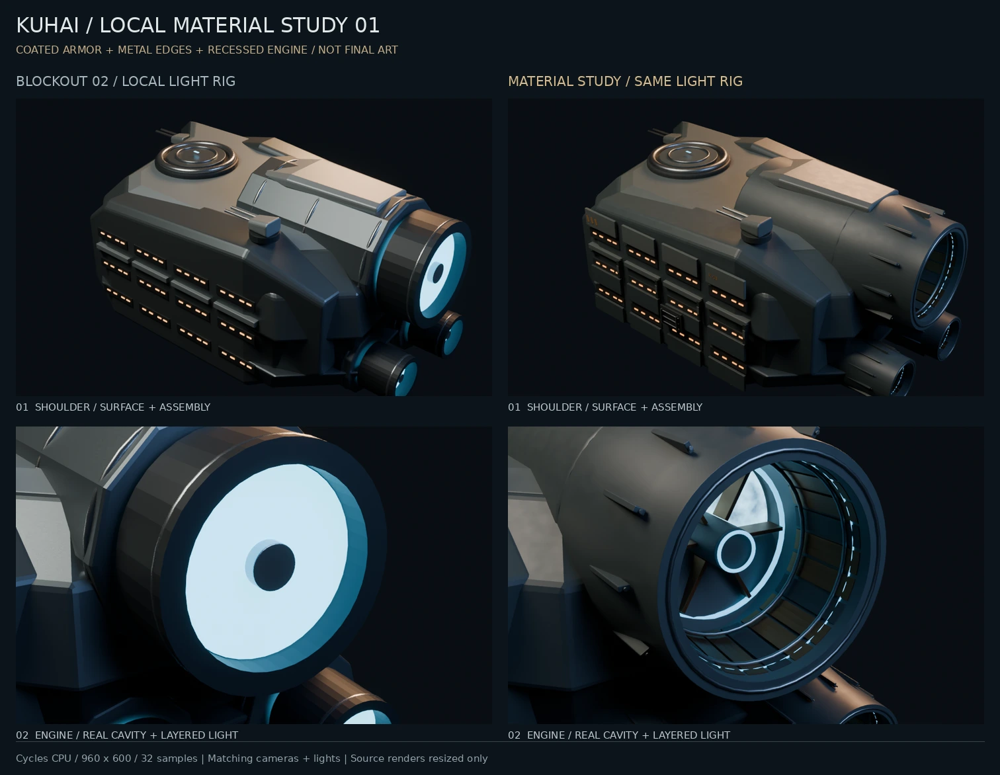

# 肩部与喷口材质样板 01

日期：2026-10-10。接续结构草模 02。状态：**局部材质与生产流程验证件；最终舰型及整舰电影质感尚未定稿**。

## 本轮成果

从草模 02 截取一侧后肩，建立独立源场景，保留基础体量作为对照。没有覆盖原整舰 `.blend`，没有改博客 UI 或线上首页。

- 漆面、裸露合金、深色内衬、暖色涂装使用不同材质；普通漆面按非金属处理，裸露合金使用金属反射。
- 装甲增加局部检修盖、接缝、少量紧固件、管路和维护边缘擦痕。细节集中在可解释的位置，尚未铺满整舰。
- 原发光圆盘改为真实纵深的喷口，包含分段内衬、径向支撑、后置光源、中心部件与较靠前的细灯圈。
- 完成一块漆面的 CPU 烘焙、独立 GLB 导出，以及 GLB 实际回读渲染。源材质和网页材质分开。

小样迭代修正了过亮的裸金属外壳、斜视时完全失读的发光层，以及圆筒的面状明暗。最终对照使用同一局部灯光、相机、960×600 分辨率和 32 次采样；左图是在本轮局部灯光下重新渲染的草模 02，不是上一轮整舰预览的原灯光。

## 实际采用的纹理与技术依据

| 来源 | 查阅/采用情况 | 使用范围 |
| --- | --- | --- |
| [Blue Metal Plate](https://polyhaven.com/a/blue_metal_plate)，Rob Tuytel / Poly Haven；[许可](https://polyhaven.com/license) | 页面、作者、CC0 许可已核对；4K roughness JPG 已下载并目视 | 仅作为小幅粗糙度变化。按页面的 2.5 m 宽度设置平铺；预览使用 1024 副本。没有采用颜色、法线或置换图 |
| [glTF 2.0 规范](https://registry.khronos.org/glTF/specs/2.0/glTF-2.0.html#materials) | 已读材质纹理及颜色空间要求 | 颜色用 sRGB；金属/粗糙度用线性数据，G 存粗糙度、B 存金属度。转换后还实际回读验证 |
| Blender 4.5.14 的实际节点与导出器 | 在本轮运行时直接验证节点参数、CPU 烘焙与 glTF 导出/导入 | 官方手册网页抓取受限，未声称读到其完整内容；以固定运行时实测记录为准 |

原图：6,219,260 bytes，SHA-256 `668f46c12a5ff663f2e7c96d909e1c5664f2fab53c24544ac512600b16ad650e`。纹理原图与本轮衍生副本都随任务包保存，并附出处。其他图像来源没有混入本轮模型。

喷口结构、光圈、K-03 维护标识都是项目创作，不能当成官方内构或经过计算的真实推进系统。材质与布置是视觉样板，没有证明官方舰船采用某种材料或装甲厚度。

## 源模型与网页样片

| 产物 | 数据 | 边界 |
| --- | --- | --- |
| `shoulder-material-study.blend` | 913,759 bytes；95 个基础肩部对象 + 330 个细节对象；网格合计 91,268 三角形，不含字体和隐藏旧版对照 | 可编辑局部源场景，非整舰低模 |
| 已打包粗糙度副本 | 1024×1024，487,419 bytes，Non-Color | 当前预览规格；4K 原图保留 |
| `armor-material-swatch.glb` | 339,752 bytes（约 332 KiB）；1 网格、2 三角形、1 材质、3 张内嵌贴图 | 一块 2.5 m 漆面平片，非肩部网页模型 |
| 烘焙贴图 | 1024 颜色、粗糙度、切线法线、ORM | ORM 的 R=1，G=粗糙度，B=0；没有烘焙 AO，也没有把螺栓/喷口几何烘焙进去 |

源材质到烘焙材质、以及实际 GLB 回读，均在相同 Blender 灯光和机位渲染。中心 200×200 RGB 区域的平均通道差约 0.717/255，最大 2/255。这只是该局部试片在此机位的转换检查，不是全图感知误差、最终视觉保证或跨浏览器一致性结论。

## 云端实测

环境复核：Blender Foundation `bpy 4.5.14 LTS` / Python 3.11.17；8 核 CPU 配额、8 GiB 内存限制；使用 6 个 CPU 线程。无可用 GPU。

| 操作 | 参数 | 耗时 |
| --- | --- | ---: |
| 肩部样板 | 960×600，32 次采样 | 10.576 s |
| 喷口近景 | 同上 | 16.555 s |
| 装甲近景 | 同上 | 15.212 s |
| 颜色烘焙 | 1024，8 次采样 | 0.666 s |
| 粗糙度烘焙 | 同上 | 0.794 s |
| 法线烘焙 | 同上 | 2.359 s |
| 迁移目录后喷口小样 | 640×400，16 次采样 | 4.868 s |

最终局部渲染批次 RSS 高水位约 1002 MiB，烘焙/回读进程约 735 MiB。以上是离线 CPU 时间和系统内存，不是网页帧率或 GPU 显存。本轮没有本地 GPU 交接需求，未调用家中电脑或付费服务；最终制作目标保持。

## 交付与剩余工作

`kuhai-flagship-material-study-01.zip` 包含可编辑源文件、原始/衍生纹理、网页漆面样片、生成/渲染/烘焙/检查脚本、版本依赖、预览和实测记录。启动说明见 [材质任务包说明](../../../tools/flagship/MATERIAL_STUDY.md)，文件校验值见 [交付记录](../assets/material-study-01-delivery.json)。

已完成无旁置贴图的跨目录重开和渲染。源文件纹理打包且路径相对，GLB 图片内嵌，单个网格闭合与对照静态变换检查通过。未完成 Windows、本地 3060 Ti 或浏览器验收。

目前肩部排列仍偏规整，远距离喷口亮度、维护逻辑、热防护形状和磨损尺度还需要结合整舰观察。下一步先把局部材质方向放回整舰低分辨率预览，连同星体主光检查远近景一致性；同时继续核对舰首和侧面参考。尚不开始全舰密集细节、完整内部工程或最终高清批量渲染。
